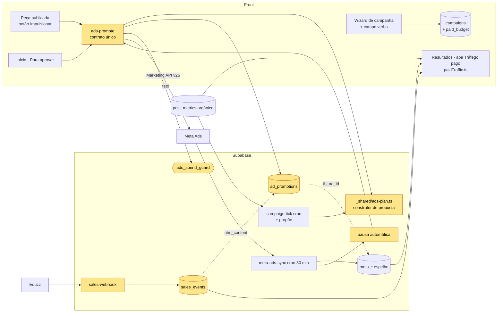

# PLANO ANTIGO — Tráfego pago (substituído em 2026-11-15)

> Arquivado. Valeu de 09 a 15/11/2026 e foi trocado pelo módulo de tráfego separado (ver `PLANO.md`). A etapa B (vendas pela Eduzz, §6.5 e §7) ainda serve de base quando a missão chegar lá.

Repositório: `piccini-dev/hive-resgate` · Base: `main` em `fb0591e` · Data: 2026-11-09
Plano anterior (operação resgate, blocos 01–10): [`PLANO-RESGATE.md`](PLANO-RESGATE.md). Os blocos 07–10 dele continuam parados; os deste plano começam no **11** para não colidir.

## 1. Objetivo e critério de pronto

**Objetivo:** o Marcos impulsiona e anuncia os conteúdos da Hive na Meta (Facebook/Instagram) **do mesmo jeito que cria posts**. A Hive propõe, ele aprova com um clique e vê o resultado. Primeiro para distribuir conteúdo; depois, para vender (Eduzz).

**Princípio que governa tudo (para não repetir o que o resgate desfez):**
> **Anúncio = peça da Hive + verba + objetivo.** Não existe criador de anúncio, "campanha de ads" paralela nem tela nova de resultados. A campanha da Hive é o contêiner, a peça é o criativo, a aprovação é a mesma esteira e os números caem em Resultados.

**Pronto quando:**
1. Uma peça publicada no Instagram pode ser impulsionada em **2 cliques** (Impulsionar → Aprovar), sem o Marcos ver conjunto, lance ou segmentação.
2. A Hive **propõe sozinha** o que impulsionar (peça acima da média orgânica, dentro da verba da campanha), e a proposta aparece no Início como "Para aprovar".
3. Nenhum centavo é gasto acima do **teto mensal** que o Marcos definiu: o servidor recusa e a recusa é testada.
4. Resultados tem **uma** aba "Tráfego pago", com resultado por campanha da Hive, por peça e pago × orgânico. O `PaidTrafficSection` sai do comparativo de contas.
5. (Etapa de vendas) Uma compra na Eduzz chega por webhook, é ligada ao anúncio que a gerou e entra no ROAS real da campanha, incluindo as compras posteriores que a Meta não vê.
6. A regressão completa fica verde e os specs novos cobrem propor, aprovar, recusar por teto e pausar.

## 2. Escopo

**Entra:**
- **Etapa A · Distribuição (blocos 11–15):** ligar anúncio ↔ peça ↔ campanha, impulsionar post publicado, propostas automáticas, guardas de verba e pausa automática.
- **Etapa B · Vendas (blocos 16–18):** produto com link de checkout, webhook de vendas, anúncio de venda feito com peça da Hive (anúncio que não aparece no feed, o "dark post"), remarketing para quem engajou e ROAS real.
- Migrations aditivas e Edge Functions novas: esta missão **publica no banco e nas funções**, sempre com ordem do Raul (ver §8).

**Não entra:**
- LinkedIn Ads, Google Ads e TikTok.
- Hotmart e Kiwify (o Marcos vende pela Eduzz).
- Gerenciador de anúncios dentro da Hive (editar conjunto, lance, segmentação detalhada, testes A/B manuais). Para isso, o link "abrir no Gerenciador" basta.
- Criativo gerado fora da esteira de peças (a IA não escreve "texto de anúncio" solto: o texto é o da peça).
- Piloto automático que gasta sem aprovação. Na v1, **toda** verba nova passa por um clique do Marcos (ver decisão D2).
- Operar contas de anúncio de terceiros (clientes da Bee). Exige acesso avançado e revisão do app pela Meta; fica para depois.

## 3. Usuários e fluxos

**Marcos** opera sozinho, não é técnico e quer o mínimo de decisões. **Raul** configura a conta de anúncio e os tetos.

### F1 · Configurar (uma vez, Raul + Marcos)
1. Configurações › Contas › Meta: reconectar o Facebook (o login passa a pedir `ads_management`).
2. Escolher a **conta de anúncio padrão**, a Página e o Instagram que anunciam (a Hive sugere pelo que o sync já trouxe).
3. Definir o **teto mensal** (R$) e o **teto diário** por anúncio.

### F2 · Campanha com verba (o caminho principal)
1. Criar → Campanha (wizard atual). No passo da estratégia aparece um campo novo e opcional: **"Verba para anúncios no período"** (R$).
2. A campanha nasce como hoje. A verba fica guardada na campanha.
3. As peças da campanha são publicadas pela Agenda, como hoje.
4. **A Hive propõe** (cron diário `campaign-tick`): 24–48 h depois de publicar, a peça com desempenho orgânico acima da mediana da conta (`post_metrics`) vira proposta, com verba, duração e objetivo definidos pela função estratégica da peça (§6.3) e um motivo em uma frase.
5. Início › "Para aprovar": **Aprovar** · **Ajustar verba** · **Recusar**.
6. Aprovar → contrato `ads-promote` cria campanha, conjunto e anúncio na Meta, dentro do teto.
7. Durante a veiculação: a pausa automática (§6.4) age; o Marcos recebe aviso no Início.
8. Resultados › Tráfego pago mostra quanto rendeu.

### F3 · Impulsionar avulso
1. Peça publicada (Agenda ou editor da peça) → botão **Impulsionar**.
2. A Hive preenche a proposta (mesmo construtor do F2). O Marcos aprova ou ajusta a verba.
3. Se a peça não é de campanha, a verba sai só do teto mensal.

### F4 · Vender (Etapa B)
1. Minha identidade › Produtos e ofertas: cada produto ganha o **id do produto na Eduzz** e o **link de checkout**.
2. Campanha `vendas` (o tipo já existe, com `product_id`): as peças de função `produtos` viram propostas de **anúncio de venda**. É um anúncio que não aparece no feed, criado da arte e do texto da peça, com o link do checkout marcado com `utm_content=hive_<promotion_id>` (a Eduzz devolve as UTMs no webhook).
3. Proposta de **remarketing**: público de quem engajou com o Instagram nos últimos 30/60 dias, com a mesma aprovação de um clique.
4. A compra chega por webhook → `sales_events` → ligada à promoção pelo `utm_content` → ROAS real por campanha e produto.

## 4. Arquitetura

O que já existe e é reaproveitado está em cinza; o novo está destacado.

**Regras de arquitetura:**
- **Um contrato por tema (regra 7 do AGENTS):** criar, pausar, retomar e encerrar anúncio passam só por `ads-promote`, como agendar passa pelo `schedule-piece`.
- **Uma fonte de proposta:** `_shared/ads-plan.ts` é puro (sem rede). O `campaign-tick` (proposta automática), o `ads-promote` (validação final) e o front (prévia, via bundle como o `campaign-plan`) usam o mesmo construtor.
- **Uma fonte de números:** métricas de anúncio vêm só do espelho `meta_ad_insights_daily`, já sincronizado. `ad_promotions` guarda a **intenção** (o que a Hive pediu), não métricas. Nada de tabela de métricas nova.
- **Uma análise:** `src/lib/campaign/paidTraffic.ts` ganha recortes por campanha da Hive e por peça. Não nasce outro cálculo.

## 5. Stack e versões

Mantida (`package.json`, ver `PLANO-RESGATE.md` §5). **Nenhuma dependência nova:** a Marketing API é chamada por `fetch` no Deno, como o `_shared/meta-ads.ts` já faz.

| Peça | Versão | Conferido |
|---|---|---|
| Meta Graph / Marketing API | **v26.0** (o código atual usa v21.0 em `_shared/meta-ads.ts` e nas funções do Instagram) | Context7, docs oficiais da Meta, 2026-11-09 |
| Permissões | `ads_read` + `ads_management` com **acesso padrão** (basta para contas de anúncio que o próprio usuário administra; acesso avançado só para terceiros) | idem |
| Eduzz Webhook | evento `myeduzz.invoice_paid`; assinatura no header `x-signature` = HMAC-SHA256(segredo, corpo); origem em `data.utm.*` e `data.tracker.code1..3`; produto em `data.items[].productId` | Context7, developers.eduzz.com, 2026-11-09 |

## 6. Modelo de dados

Tudo **aditivo** e idempotente, com rollback em `supabase/rollback/`. RLS `auth.uid() = user_id` em toda tabela nova (padrão do `20261002000001_trafego_pago.sql`).

### 6.1 Novas colunas
| Tabela | Coluna | Tipo | Para quê |
|---|---|---|---|
| `meta_connections` | `ad_account_id` | text | conta de anúncio padrão (`act_…`) |
| | `page_id` | text | Página que anuncia |
| | `ig_account_id` | text | Instagram que anuncia |
| | `monthly_cap` | numeric | teto mensal em R$ (nulo = não anuncia) |
| | `daily_cap` | numeric | teto diário por anúncio em R$ |
| `campaigns` | `paid_budget` | numeric | verba de anúncios no período (nulo = sem anúncio) |
| `bee_products` (etapa B) | `eduzz_product_id` | text | id do produto na Eduzz (`items[].productId`) |
| | `checkout_url` | text | link do checkout |

### 6.2 `ad_promotions` (a intenção da Hive)
| Campo | Tipo | Nota |
|---|---|---|
| `id` | uuid pk | |
| `user_id` | uuid fk auth.users | RLS |
| `post_id` | uuid fk user_posts | a peça (criativo) |
| `campaign_id` | uuid fk campaigns null | herda da peça |
| `kind` | text check (`boost`,`sale`,`remarketing`) | `boost` = post publicado; `sale` = anúncio fora do feed (dark post) |
| `objective` | text | `OUTCOME_AWARENESS` · `OUTCOME_ENGAGEMENT` · `OUTCOME_TRAFFIC` · `OUTCOME_SALES` |
| `status` | text check | `proposed` → `approved` → `creating` → `active` ↔ `paused` → `ended`; também `rejected`, `failed` |
| `daily_budget` | numeric | R$ |
| `days` | smallint | duração |
| `starts_at` / `ends_at` | timestamptz | |
| `reason` | text | motivo da proposta, em uma frase (mostrado ao Marcos) |
| `origin` | text check (`auto`,`manual`) | |
| `fb_campaign_id`, `fb_adset_id`, `fb_ad_id`, `fb_creative_id` | text | ligam ao espelho `meta_*` |
| `paused_reason` | text | regra que pausou, ou "manual" |
| `error` | text | última recusa da Meta |
| `approved_at`, `created_at`, `updated_at` | timestamptz | |

Índice único parcial: uma promoção ativa ou proposta por (`post_id`, `kind`).

### 6.3 Objetivo por função estratégica (em `_shared/ads-plan.ts`)
| Função da peça | Objetivo Meta | Leitura para o Marcos |
|---|---|---|
| presença, posicionamento | `OUTCOME_AWARENESS` | "Alcançar mais gente" |
| autoridade, relacionamento | `OUTCOME_ENGAGEMENT` | "Gerar conversa" |
| produtos (etapa A) | `OUTCOME_TRAFFIC` | "Levar para a página" |
| produtos em campanha `vendas` (etapa B) | `OUTCOME_SALES` | "Vender" |

Público: Advantage+ (público automático da Meta) com país BR. O Marcos não escolhe segmentação.

### 6.4 Guardas
- **`ads_spend_guard(user)`** (função SQL): soma o comprometido no mês (`ad_promotions` ativas e aprovadas × diária × dias restantes, mais o gasto real do espelho) e compara com `monthly_cap`. O `ads-promote` chama antes de criar ou retomar; acima do teto, recusa com código `PT402`.
- **Pausa automática** (no `meta-ads-sync`, depois de sincronizar): pausa pelo `ads-promote` quando (a) gastou 2× a diária sem nenhum resultado do objetivo, ou (b) a frequência média passa de 3,5. Limiares em constantes num só lugar.
- **Botão "Pausar todos os anúncios"** em Configurações › Contas › Meta.

### 6.5 `sales_events` (etapa B)
`id`, `user_id`, `event` (`myeduzz.invoice_paid`, reembolso, chargeback… — lista conferida no bloco 16), `invoice_id` (único, para idempotência), `product_id` fk `bee_products` null, `amount`, `currency`, `utm` jsonb, `promotion_id` fk `ad_promotions` null (resolvido do `utm_content`), `buyer_hash` (sha256 do e-mail normalizado, nunca o e-mail), `occurred_at`, `raw` (payload **sem** dados pessoais: nome, e-mail, telefone e documento removidos antes de gravar).

## 7. Integrações

### Meta Marketing API (Graph v26.0)
- **Impulsionar post (boost):**
  1. `POST /act_{id}/campaigns` (objective, `special_ad_categories=[]`, `status`);
  2. `POST /act_{id}/adsets` (daily_budget em centavos, `targeting` BR + Advantage+, `optimization_goal` coerente com o objetivo);
  3. `POST /act_{id}/adcreatives` com `object_id` (Página), `instagram_user_id` e `source_instagram_media_id` (= `user_posts.metadata.ig_media_id`);
  4. `POST /act_{id}/ads`.
- **Anúncio de venda (dark post, etapa B):** criativo com `object_story_spec` (imagem ou carrossel exportado da peça, texto da peça, link do checkout com `utm_content`). O formato exato do `object_story_spec` e do carrossel é **conferido no Context7 no bloco 17**.
- **Remarketing:** público personalizado de engajamento do Instagram (conferir o `subtype` e a regra no bloco 17).
- **Pausar/retomar/encerrar:** `POST /{object_id}` com `status=PAUSED|ACTIVE`.
- Token: o mesmo token longo de `meta_connections` (nunca vai ao navegador). Erros da Meta são gravados em `ad_promotions.error` e mostrados em português.

### Webhooks de venda (etapa B)
- `sales-webhook` (função pública, `verify_jwt=false`), só Eduzz: recalcula o HMAC-SHA256 do corpo cru com `EDUZZ_WEBHOOK_SECRET`, compara com `x-signature` em tempo constante (401 se não bater), limpa os dados pessoais e faz upsert em `sales_events` por `invoice_id`. Outra plataforma só se o Marcos passar a usar.

### Front
- `src/lib/edge.ts`: `adsPromote({ action: 'propose'|'approve'|'reject'|'pause'|'resume'|'end', ... })`.
- `src/lib/ads.ts`: leitura de `ad_promotions` e das configurações (REST via `db.ts`).

## 8. Convenções

- **Regras técnicas:** `AGENTS.md`. Diferença desta missão: o §0 do AGENTS ("nunca publique Edge Function ou migration") vale para os agentes externos, mas o plano **precisa** de deploy. Todo deploy de migration ou função é tarefa `exec:claude` e só roda com ordem explícita do Raul, na ordem do AGENTS §3: migration aditiva → função → app.
- **Pastas:** `supabase/functions/ads-promote/`, `supabase/functions/sales-webhook/`, `supabase/functions/_shared/ads-plan.ts` (puro), `_shared/meta-marketing.ts` (chamadas de escrita, separadas do sync de leitura), `src/lib/ads.ts`, `src/components/ads/` (cartão de proposta, botão Impulsionar), aba em `src/pages/desempenho/`.
- **UI sem jargão:** nada de "adset", "CPM" ou "lance" para o Marcos. CPA, ROAS e CPM só no detalhe recolhido.
- **Testes:**
  - `e2e/unit-ads-plan.spec.ts`: construtor de proposta (objetivo por função, verba que respeita o teto, sem proposta para peça sem `ig_media_id`) e pausa automática (limiares).
  - E2E com `mockEdge` para o `ads-promote` (propor, aprovar, recusar por teto, pausar). **A Meta nunca é chamada nos testes** (regra 1: aqui ela gasta dinheiro).
  - Uma prova real por bloco que cria anúncio: `exec:claude`, na conta de anúncio do Raul, com `status=PAUSED`, apagada no fim. Só com ordem.
- **Ambiente** (nomes): os atuais + `EDUZZ_WEBHOOK_SECRET` (Secrets do Supabase, etapa B). `.env.example` atualizado.

## 9. Segurança e dados pessoais

- **Dinheiro é dado sensível:** o teto é verificado **no servidor** (`ads_spend_guard`), nunca só no front. Testes cobrem a recusa.
- **Nada ativa sozinho:** `ads-promote` só cria com `status=ACTIVE` em promoção `approved` por usuário autenticado; o cron só **propõe**. A pausa automática só reduz gasto, nunca aumenta.
- **Token da Meta** continua só no banco (RLS + service role); o `getMetaConnection` não devolve o token.
- **Webhook público:** valida o segredo da plataforma, faz upsert idempotente e devolve 401 sem segredo. Limite de tamanho do corpo.
- **LGPD (compradores):** só `buyer_hash`; nome, e-mail, telefone e CPF são retirados do `raw` antes de gravar. Retenção e base legal (execução de contrato e legítimo interesse do vendedor) registradas no bloco 16. **Auditoria de segurança** (módulo producao-cliente) nos blocos 13 e 16.
- **Site de teste = banco real:** um anúncio aprovado no site de teste gasta de verdade. A faixa "versão de teste" ganha esse aviso na tela de aprovação (ver risco R2).

## 10. Blocos

| NN | Nome | Objetivo | Entregável verificável | Depende de | Tarefas |
|---|---|---|---|---|---|
| 11 | Base do tráfego | Consolidar o que existe e preparar a escrita | Aba "Tráfego pago" em Resultados (o comparativo deixa de ter a seção); Graph v26 no `_shared`; login pede `ads_management`; conta, Página, Instagram e tetos salvos em Configurações; migration 6.1 (parte A) + 6.2 aplicada | — | 6 |
| 12 | Anúncio ↔ peça ↔ campanha | Medir o pago no lugar certo antes de gastar | Resultados › Tráfego pago por campanha da Hive e por peça; editor da peça mostra "pago × orgânico" quando houve anúncio; ligação via `ig_media_id` e `ad_promotions` | 11 | 5 |
| 13 | Impulsionar | Contrato `ads-promote` + botão na peça | Peça publicada → Impulsionar → Aprovar cria na Meta (prova real em PAUSED); recusa por teto (`PT402`) testada; pausar e retomar | 11 | 7 |
| 14 | A Hive propõe | Proposta automática no ritmo da campanha | Campo "verba" no wizard; `campaign-tick` cria propostas; cartão no Início com Aprovar / Ajustar / Recusar; prévia usa o mesmo `ads-plan` | 13 | 6 |
| 15 | Guardas | Gastar só o que rende | Pausa automática no sync; "Pausar todos"; avisos no Início; regressão completa verde → **fim da etapa A** | 14 | 5 |
| 16 | Vendas: dados | Saber quanto vendeu de verdade | Produto com plataforma e checkout; `sales-webhook` da Eduzz com assinatura HMAC; `sales_events` sem dados pessoais; auditoria de segurança | 15 | 6 |
| 17 | Vendas: anúncios | Anunciar para vender, com peça da Hive | Proposta `sale` (dark post) com link `utm_content` em campanha `vendas`; proposta `remarketing`; prova real em PAUSED | 16 | 7 |
| 18 | Vendas: resultado | ROAS real e compra posterior | Tráfego pago mostra vendas da plataforma × Meta, ROAS real por campanha e produto e compra posterior do mesmo comprador (`buyer_hash`); regressão verde | 17 | 5 |

Ordem: 11 → 12 e 13 em paralelo → 14 → 15 → 16 → 17 → 18. O bloco 12 não depende do 13 (mede o que já existe).

### Issues planejadas por bloco

Só as do bloco atual viram issue (`/issues`). As seguintes são detalhadas no `/integrar` do bloco anterior, sobre o código já integrado.

**11 · Base do tráfego**
- `exec:gpt` Nova aba `trafego` em `Resultados.tsx`, renderizando o `PaidTrafficSection` com as contas do Instagram; o `AccountsCompare` passa a ter só o orgânico e um link para a aba.
- `exec:gpt` Trocar `v21.0` por `v26.0` em `_shared/meta-ads.ts` e nas funções que montam URL da Graph (lista por `grep -rn "v21.0" supabase/functions`). Conferir no changelog da Meta os campos removidos entre v21 e v26 que o sync usa.
- `exec:gpt` Somar `ads_management` ao `IG_SCOPE` do `AccountsPanel.tsx` e trocar o comentário "guardado pra uso futuro".
- `exec:claude` Migration aditiva: colunas 6.1 em `meta_connections` e `campaigns` + tabela `ad_promotions` + RLS + rollback. Deploy só com ordem.
- `exec:gpt` Configurações › Contas › Meta: escolher conta de anúncio, Página e Instagram (listas a partir de `meta_ad_accounts` e das contas sociais) e os dois tetos; gravar em `meta_connections`.
- `exec:claude` Cadastrar `hive-resgate.netlify.app` nas URIs de redirecionamento do OAuth no app da Meta (o Raul faz no painel) e conferir que o Facebook do Marcos tem papel no app (R4).
- `exec:claude` Redeploy de `meta-ads-sync`/`meta-ads-attribution` em v26 (com ordem), reconectar o Facebook com o novo escopo e E2E da aba.

**12 · Anúncio ↔ peça ↔ campanha**
- Em `paidTraffic.ts`: recorte por peça (`meta_ads.ig_media_id` → `user_posts.metadata.ig_media_id`) e por campanha da Hive (`user_posts.campaign_id`, ou `ad_promotions.campaign_id` quando houver). Testes unitários.
- Aba Tráfego pago: seletor "por conta / por campanha"; tabela de peças com pago × orgânico.
- Editor da peça: bloco "Anúncios desta peça" (gasto, alcance pago, resultado) quando existir anúncio.
- `paidInsights`: conclusões por campanha da Hive (reaproveita as atuais).
- `exec:claude` E2E com seed de `meta_ads`/`meta_ad_insights_daily` do usuário de teste (somar as tabelas `meta_*` ao `E2E_OWNED_TABLES`).

**13 · Impulsionar**
- `_shared/ads-plan.ts` (puro): `buildProposal(piece, campaign, settings, spentThisMonth)` → objetivo (6.3), diária, dias e motivo; e o bundle para o front (`npm run build:edge-shared`). Testes.
- `_shared/meta-marketing.ts`: criar campanha, conjunto, criativo e anúncio; pausar, retomar e encerrar (só `fetch`).
- `exec:claude` Migration `ads_spend_guard` + rollback.
- `ads-promote/index.ts`: ações `propose|approve|reject|pause|resume|end`, guarda, transições de status e erro da Meta em português.
- `src/lib/ads.ts` + `edge.adsPromote`; botão **Impulsionar** no `PieceActionsPanel`, só para peça publicada no Instagram com `ig_media_id`.
- Diálogo de aprovação: verba, dias e objetivo em linguagem simples; aviso de site de teste.
- `exec:claude` Deploy (com ordem), prova real em PAUSED na conta do Raul, E2E com `mockEdge` (aprovar, recusar por teto) e auditoria de segurança.

**14 · A Hive propõe**
- Campo "Verba para anúncios" no passo da estratégia do wizard → `campaigns.paid_budget`.
- `campaign-tick`: depois do trabalho atual, para campanhas com verba, gera propostas pelo `ads-plan` com `post_metrics` (acima da mediana da conta, 24–48 h depois de publicar). Idempotente.
- Início: cartão "Para aprovar · anúncios" (reaproveitar o padrão de pendências de `lib/campaign/home.ts`).
- Aprovar / Ajustar verba / Recusar no cartão, todos pelo `ads-promote`.
- `exec:claude` Deploy do `campaign-tick` (com ordem) e E2E da proposta.

**15 · Guardas**
- Pausa automática em `meta-ads-sync`, com os limiares numa constante e testes unitários.
- "Pausar todos os anúncios" em Configurações.
- Avisos no Início (pausado por regra, teto perto do fim).
- `exec:claude` Deploy, regressão completa, `/impeccable critique` + `polish` nas telas novas e nota para o Marcos.

**16–18 · Vendas** — detalhados no `/integrar` do 15. Antes do 16, a resposta da pergunta P3 (§11).

## 11. Riscos e perguntas em aberto

| # | Risco | Mitigação |
|---|---|---|
| R1 | O "Conectar Facebook" (OAuth da Meta) pode recusar o endereço `hive-resgate.netlify.app` | Cadastrar o domínio nas URIs de redirecionamento do app da Meta no bloco 11 (`exec:claude`, o Raul faz no painel da Meta) |
| R2 | Anúncio aprovado no site de teste gasta de verdade (mesmo banco) | Aviso no diálogo de aprovação + teto mensal |
| R3 | Graph v21 perto do fim ou já sem suporte (a Meta redireciona para a versão mais antiga disponível) | Subir para v26 no bloco 11, antes de escrever |
| R4 | O acesso padrão só vale se o usuário do Facebook do Marcos tiver papel no app da Meta ou se a conta de anúncio for do mesmo Business do app | Conferir no bloco 11 (`exec:claude`); se não tiver, dar papel de testador ou pedir acesso avançado (revisão da Meta, semanas) |
| R5 | A Meta rejeita o anúncio (política, conta restrita) | `failed` + mensagem em português no cartão; nada de nova tentativa automática |
| R6 | Testes não podem chamar a Meta | `mockEdge` no E2E; prova real só em PAUSED, com ordem |
| R7 | Dados pessoais de compradores no webhook | `buyer_hash` + `raw` limpo + auditoria no 16 |

**Decisões:**
- **D1 · Onde o Marcos usa o tráfego:** no `hive-resgate.netlify.app`, até o Raul mandar trocar o domínio (decidido em 09/11). A faixa "versão de teste" continua; nada no plano depende da virada.
- **D2 · Aprovação sempre manual na v1** (nenhum gasto sem clique). O piloto automático dentro do teto pode vir depois de 1 mês de uso.
- **D3 · Valores iniciais:** teto diário padrão R$ 30, duração padrão 5 dias e pausa automática em 2× a diária sem resultado ou frequência acima de 3,5. Ajustáveis.

**Perguntas em aberto:**
- **P1** Qual conta de anúncio o Marcos quer usar (o sync já trouxe as dele; há próprias e de cliente)?
- **P2** O usuário do Facebook do Marcos tem papel no app da Meta da Hive? (R4)
- **P3** (Etapa B) O Pixel da Meta já está na página de checkout? O histórico tem compras atribuídas pela Meta, então provavelmente sim.
