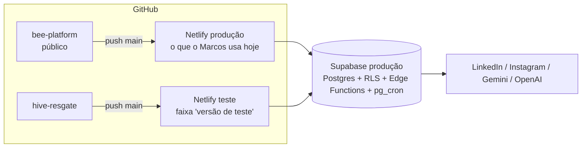

# PLANO — Operação resgate da Hive

Repositório: `raulmf12/hive-resgate` (titularidade em transferência; consultar visibilidade no GitHub) · Base: `bee-platform` em 407a6e5 · Data: 2026-11-04
Diagnóstico completo: [`.central/RELATORIO-ENXUGAMENTO.md`](../../.central/RELATORIO-ENXUGAMENTO.md)

## Atualização operacional — 05/11/2026

Marcos autorizou a autonomia de seus agentes: não há revisão obrigatória do Raul. [AUTONOMIA-MARCOS](../agentes/AUTONOMIA-MARCOS.md) e [REGRESSAO-GITHUB](../agentes/REGRESSAO-GITHUB.md) regem o fluxo e prevalecem sobre atribuições históricas dos blocos abaixo. Preserve escopo, sequência e dependências do resgate; não reatribua tarefas em execução sem coordenação. A transferência de titularidade, a proteção da `main`, os segredos e o acesso ao Netlify precisam de confirmação técnica separada.

## 1. Objetivo e critério de pronto

**Objetivo:** devolver ao Marcos uma Hive que ele entende e usa sem se perder. Menos telas, um caminho por tarefa e nada que pareça funcionar sem funcionar.

O problema não é erro técnico: são fluxos **confusos, longos e sem nexo**, resultado de funções acumuladas sem metodologia.

**Pronto quando:**
1. O menu tem 15 itens (hoje 26) e cada tarefa do Marcos tem um caminho só (relatório §0 e §6).
2. Nenhuma tela ou campo grava algo que ninguém lê.
3. Os fluxos principais (criar → produzir → aprovar → agendar → publicar) têm o número de passos medido no bloco 01 e reduzido no bloco 09.
4. A regressão completa está verde no repositório novo.
5. O Marcos validou no site de teste, e o domínio dele passou a apontar para a versão nova.

## 2. Escopo

**Entra:**
- Front-end (React), código de cliente e testes.
- Redirecionamento das rotas antigas.
- Site Netlify de teste.
- Medição de uso no banco (só leitura).
- Simplificação dos fluxos principais.

**Não entra nesta operação:**
- **Apagar Edge Functions ou tabelas.** O banco e as funções são os mesmos da produção; o front apenas para de chamá-las. Apagar fica para uma fase posterior, depois da virada e de um prazo sem reclamação.
- Deploy de Edge Function ou migration fora de um escopo explicitamente autorizado pelo Marcos, com acesso, verificação e rollback. A conexão administrativa não amplia o escopo comum do resgate.
- Unificar "público" (relatório §3.7) e juntar Templates com as matrizes Hive (relatório §3.8). As duas mexem no prompt e na arte e ficam para depois.
- Funcionalidade nova.

## 3. Usuários e fluxos

**Marcos** (único usuário real; não técnico) usa todo dia. **Raul** é parceiro técnico; Marcos decide prioridades e publicação e pode autorizar agentes sem revisão obrigatória do Raul.

### Fluxos-alvo depois do resgate
1. **Campanha:**
   1. Criar → Campanha.
   2. Leitura do momento → estratégia → duração.
   3. Campanha criada → Produção do ciclo (pauta → ideias → desenvolvimento → revisão).
   4. As peças aprovadas caem na fila da Agenda.
2. **Conteúdo avulso:**
   1. Criar → Um conteúdo (texto, imagem, carrossel).
   2. Mesma esteira de desenvolvimento e revisão → Agenda.
3. **Vídeo:** Criar → Vídeo (fluxo atual de corte, `/podcasts/novo`) → peça → Agenda.
4. **Agendar e publicar:**
   1. Agenda → arrastar para o dia ou "Agendar na janela sugerida".
   2. O `publish-scheduler` publica.
   3. Desempenho mostra o resultado.
5. **Ensinar a voz:**
   1. Ensinar a Hive (Coach): conversar, registrar observação ou ativar e desativar lições.
   2. Curadoria aprova o que a IA minerou.
6. **Ajustar a base:** Voz da Hive (Identidade, Como escrevo, Editoriais, Conhecimento).

O passo a passo atual de cada fluxo, com cliques e telas, é medido no bloco 01 (`docs/plano/FLUXOS.md`).

## 4. Arquitetura

Igual à de hoje (`docs/agentes/01-CONTEXTO.md` §3). O que muda é **onde o front publica**:

- Os dois sites usam o **mesmo** banco e as mesmas funções. No site de teste, aprovar, agendar e publicar **valem de verdade**. Por isso ele mostra a faixa de aviso (issue 01-A).
- **Endereço do site de teste:** https://hive-resgate.netlify.app (projeto `hive-resgate`, time RMF no Netlify). Publica só a `main`; branch deploys e deploy previews desligados; `VITE_APP_ENV=teste`. Criado em 2026-11-04.
- **Virada (bloco 10):** o domínio do Marcos passa a apontar para o site do `hive-resgate`. O `bee-platform` fica arquivado.
- Nesta pasta local, o remoto antigo se chama `producao` e tem o push desligado.

## 5. Stack e versões

Mantida, lida de `package.json` (nada novo é instalado):

| Peça | Versão |
|---|---|
| React / React DOM | ^18.3.1 |
| React Router | ^6.27.0 |
| Vite | ^5.4.10 |
| TypeScript | ~5.6.3 |
| Tailwind | ^3.4.14 |
| Zustand | ^5.0.1 |
| Fabric | ^6.4.3 |
| supabase-js | ^2.46.1 (só autenticação) |
| Playwright | ^1.63.0 |
| ESLint | ^9.13.0 |
| Node | 20 no Netlify (`netlify.toml`) e 22 no CI |

## 6. Modelo de dados

Sem mudança de schema nesta operação. Entidades e grupos: `docs/agentes/01-CONTEXTO.md` §2 e §6.

O que o front **deixa de usar** (as tabelas continuam no banco):
- `kanban_columns`, `editorial_lines`, `editorial_line_runs`;
- `alma_eventos` (escrita pelo front);
- `bee_themes` e `bee_logics` (só contagem);
- `bee_personas` e `image_model_trials` (as telas saem);
- colunas de `user_settings`: `persona`, `tone_of_voice`, `content_structure`, `brand_colors`, `brand_logo_url`;
- RPC `ai_gate_status` (painel do portão).

## 7. Integrações

Sem mudança.
- **Front → banco:** `src/lib/db.ts` (REST).
- **Front → funções:** `src/lib/edge.ts`.
- **Crons:** `publish-scheduler`, `campaign-tick`, `metrics-ingest`, `instagram-refresh`, `meta-ads-sync` (`01-CONTEXTO.md` §9).
- **Funções que o front deixa de chamar** (continuam publicadas): `hybrid-image-search`, `search-knowledge`, `distribute-schedule`, `generate-persona`, `persona-chat`, `generate-script`, `regenerate-snippet`, `nano-scene`, além do `learn-from-feedback` se o bloco 04 não o reaproveitar.
- **Site de teste:** o "Conectar Instagram" (OAuth da Meta) pode recusar o endereço novo. Conectar contas continua sendo feito pelo site de produção até a virada.

## 8. Convenções

- **Regras técnicas:** `AGENTS.md` (as da Hive valem integralmente; a seção de orquestração diz como as issues são executadas).
- **Pastas:** uma por rota em `src/pages/`, componentes em `src/components/<área>/`, contratos em `src/lib/`. Tela que sai tem o arquivo removido e a rota trocada por `<Navigate to="…" replace />`.
- **Idioma:** UI, comentários e docs em português do Brasil. Commits no formato `<tipo>(#N): Pk …`.
- **Testes:**
  - Agente externo: `npm run build` (portão) e `npx playwright test -c playwright.unit.config.ts` (funções puras, sem banco).
  - E2E e regressão completa: no GitHub, com usuário de teste isolado e sem concorrência com o repositório antigo; atualmente o workflow é manual. Marcos ou agente com acesso acompanha a evidência antes da integração de código.
- **Ambiente** (nomes apenas): `VITE_SUPABASE_URL`, `VITE_SUPABASE_PUBLISHABLE_KEY`, `VITE_FACEBOOK_APP_ID`, `VITE_APP_ENV` (novo; `teste` no site de teste). Para medir e para o E2E: `SUPABASE_ACCESS_TOKEN` em `.env.e2e.local`.

## 9. Segurança e dados pessoais

- Os dados reais são do Marcos (regra 5 do `AGENTS.md`): nada de `UPDATE` ou `DELETE` em produção sem mostrar o `SELECT` antes e sem confirmação.
- A medição de uso traz só números agregados; nada sai da máquina.
- Nunca publicar de verdade em teste (regra 1). O site de teste avisa que as ações valem de verdade.
- Segredos só em configuração segura e nos Secrets. Conferir a visibilidade real do repositório; a regra vale tanto público quanto privado.
- Remover tela não pode abrir caminho novo para dados: as remoções são só de front, e o RLS continua igual.
- Não há mudança de autenticação, RLS ou dados pessoais nesta operação. Se surgir, faz-se auditoria de segurança.

## 10. Blocos

| NN | Nome | Objetivo | Entregável verificável | Depende de | Tarefas |
|---|---|---|---|---|---|
| 01 | Base do resgate | Ambiente seguro e medição antes de cortar | Site de teste no ar com faixa; uso real medido; `FLUXOS.md` com os passos atuais | — | 5 |
| 01b | Métricas do LinkedIn | Trazer ao repositório o trabalho de 03–04/11 que só existia no zip | Patch de 16 arquivos na `main`; funções e migrations conferidas contra a produção (só leitura); regressão verde | 01 | 3 |
| 02 | Fora o morto | Tirar do front o que não tem efeito | Build verde; telas e chamadas mortas removidas; login sem escrita inútil | 01b | 6 |
| 03 | Menu novo | Configurações honestas, ferramentas internas separadas, menu de 15 itens | Menu da §6.1 do relatório; rotas antigas redirecionam | 02 | 6 |
| 04 | Ensinar a Hive | Um lugar para ensinar a voz | `/coach` com abas Conversa, Observações e Lições; `/feedback` e `/aprendizado` redirecionam; portão fora | 03 | 5 |
| 05 | Voz da Hive | Base em 4 telas | "Como escrevo" (Genesis + Diretrizes); Arsenal dentro de Editoriais; Produtos dentro da Identidade | 03 | 5 |
| 06 | Visual e resultados | Fotos, Biblioteca e Resultados juntos | Uma tela de Fotos do Marcos; Biblioteca com Vídeos; ACJ como aba de Desempenho | 03 | 5 |
| 07 | Andamento | Dois lugares para ver o andamento | Pipeline fora (contagens no Início); Agenda com um sugeridor | 03 | 4 |
| 08 | Aposentar o wizard | Dois caminhos de criação | Pendentes antigos resolvidos; `/posts/novo` redireciona; wizard removido | 07 | 6 |
| 09 | Fluxos curtos | Cortar passos sem nexo dos fluxos principais | Passos de cada fluxo reduzidos contra a medição do bloco 01 | 08 | 6–8 |
| 10 | Virada | O Marcos passa a usar a versão nova | Regressão verde; validação do Marcos; domínio trocado; nota para ele | 09 | 5 |

Blocos 04 a 07 dependem só do 03 e podem andar em qualquer ordem. A ordem acima é a recomendada.

### Issues planejadas por bloco

Só as do bloco atual viram issue no GitHub (`/issues`). As dos blocos seguintes são criadas no `/integrar` do bloco anterior, com o código já integrado, e podem ser ajustadas.

**01 · Base do resgate**
- 01-A `exec:gpt` Mostrar a faixa "versão de teste" quando `VITE_APP_ENV=teste`.
- 01-B `exec:gpt` Reescrever o `README.md` enxuto (o atual descreve a Alma).
- 01-C `exec:claude` Criar o site Netlify de teste ligado ao `hive-resgate` (o Raul faz o login).
- 01-D `exec:claude` Medir o uso real no banco (só SELECT) e atualizar o relatório §11.
- 01-E `exec:claude` Percorrer os fluxos principais, contar passos e telas, rodar `/impeccable critique` e gravar `docs/plano/FLUXOS.md`.

**01b · Métricas do LinkedIn** (decisão de 04/11: bloco próprio, antes do 02)
- `exec:claude` Aplicar `trabalho-nao-enviado.patch` (zip de transferência, base `8350a79`, 16 arquivos) e passar no build e nos unitários.
- `exec:claude` Conferir, só por leitura, que `linkedin-import` e as migrations `20261103000005/6/7` do patch são as que estão em produção. Sem deploy.
- `exec:claude` Regressão completa e merge.

**02 · Fora o morto** (relatório §4)
- Remover `LinhasEditoriais.tsx`, `GateLock.tsx` e `editorialLinesApi`.
- Remover as telas de teste M01/M02 e as rotas delas.
- Remover `kanbanApi` e a chamada `ensureDefaults()` no login (`authStore.ts`).
- Remover `almaApi` e as chamadas dele (Curadoria, PostEditor).
- Remover os métodos sem uso de `api.ts` (lista do relatório §4.4) e `edge.searchImages` / `edge.searchKnowledge`.
- Remover a lógica de item travado (`gated`) do `Sidebar.tsx`.

**03 · Menu novo** (relatório §2, §3.6 e §6)
- Remover as abas "Voz Bee" e "Branding" de Configurações.
- Tirar persona e tom do Onboarding (ele continua pedindo só a chave do Gemini).
- Remover Simular público e Teste de imagem (rotas redirecionam para `/`). O modelo de imagem vencedor fica registrado em `DECISOES.md`.
- Reorganizar o `Sidebar.tsx` no menu novo, com o grupo "Ferramentas internas" recolhido no fim (Custos, Olhar Bee, Prévia e assets do Hive).
- Ligar o Convite M04 ao Criar.
- Atualizar as specs E2E que navegam pelo menu (`baseline`, `f26-navegacao-e5`).

**04 · Ensinar a Hive** (relatório §3.3 e §3.4)
- Abas em `/coach`: Conversa (atual), Observações (conteúdo do `Feedback.tsx`) e Lições (lista e alternância de `ai_learnings`, hoje em Aprendizado).
- `/feedback` → `/coach?aba=observacoes`; `/aprendizado` → `/coach?aba=licoes`.
- Remover o painel do portão (`Aprendizado.tsx`) e `aiApi.gate`.
- Renomear no menu para "Ensinar a Hive".
- Teste E2E `exec:claude` do Coach com abas (mocks de IA).

**05 · Voz da Hive** (relatório §3.5)
- "Como escrevo": `/genesis` com abas Princípios (Genesis) e Ofício (Diretrizes); `/diretrizes` redireciona.
- Arsenal e exemplos como seção de cada editorial; `/arsenal` redireciona.
- Produtos como bloco da Identidade; `/produtos` redireciona. Antes, conferir a sobreposição com `business_fronts` (`exec:claude`).
- Atualizar a spec `f17-minha-identidade`.

**06 · Visual e resultados** (relatório §3.8, §3.9 e §2)
- Juntar `HiveMarcos` dentro de `PhotoEngine` ("Fotos do Marcos"); `/hive/marcos` redireciona.
- Biblioteca com aba Vídeos (lista de `Podcasts.tsx`); `/podcasts` redireciona; "novo corte" no Criar.
- Jornada ACJ como aba de Desempenho ("Resultados"); `/jornada` redireciona.
- Atualizar as specs `f12-marcos-photo` e `f13-acj-fluxo`.

**07 · Andamento** (relatório §3.2)
- Contagens por estágio do Pipeline no Início (reaproveitar `lib/campaign/pipeline`).
- Remover `Pipeline.tsx`; `/pipeline` → `/`.
- Remover o botão "IA distribui" da Agenda (`edge.distributeSchedule`).
- Atualizar as specs `f7-home-pipeline`, `baseline`, `f14` e `f8` (que abrem `/pipeline`).

**08 · Aposentar o wizard** (relatório §3.1)
- `exec:claude` Listar os posts antigos com texto pendente (SELECT) para o Marcos decidir: aprovar ou arquivar. Executar só com a confirmação dele.
- Trocar os links de retomada (`lib/campaign/home.ts`, `lib/postReview.ts`) para o editor da peça.
- Criar → Vídeo aponta para `/podcasts/novo`.
- Remover `NewPost.tsx`, `components/posts/wizard/*`, `lib/hive/batchCompose.ts` e `lib/templates/resolve.ts`.
- `/posts/novo` → `/criar/conteudo`.
- Remover de `edge.ts` os métodos que só o wizard usava (`generateScript`, `regenerateSnippet`).

**09 · Fluxos curtos** (definido pelo `FLUXOS.md` do bloco 01)
- 6 a 8 tarefas, uma por ponto sem nexo medido, com antes e depois em número de passos.
- `/impeccable polish` nas telas mexidas; conferência em 375 px e no desktop.

**10 · Virada**
- Regressão completa verde no GitHub, com evidência do código final a integrar.
- `exec:claude` `/entrega` (review, segurança e interface).
- `exec:claude` O Marcos valida no site de teste (roteiro curto de 5 tarefas).
- `exec:claude` Trocar o domínio no Netlify para o site novo (com decisão explícita do Marcos e rollback) e arquivar o `bee-platform`.
- `exec:gpt` Nota de versão para o Marcos (`docs/agentes/08-COMUNICACAO.md`).

**Depois da operação (fora deste plano):** apagar as Edge Functions e tabelas que o front deixou de usar (relatório §4.2, §4.3 e §5), cada uma com rollback, depois de 30 dias sem uso medido.

## 11. Riscos e perguntas em aberto

| Risco | Mitigação |
|---|---|
| O site de teste usa dados reais: o Marcos pode agendar ou publicar achando que é teste | Faixa permanente (01-A) e aviso no roteiro de validação |
| O Marcos depende de algo que parece morto | Medição (01-D) antes do bloco 02; cinco perguntas ao Marcos (relatório §9) antes dos blocos 04 a 08 |
| Os agentes externos não rodam E2E (não há token) | Especificação fechada, build e unitários; E2E e regressão rodam no GitHub e são conferidos antes do merge |
| O CI do GitHub roda a regressão contra produção | Estado atual: regressão manual e CI do PR com build/unitários. Antes do merge de código, conferir a regressão completa no código integrado à base atual; automação e proteção são configuração separada |
| Divergência entre os dois repositórios até a virada | Correção urgente no site atual entra nos dois (cherry-pick) |
| O ChatGPT precisa ler o repositório privado | Dar acesso ao `hive-resgate` na integração GitHub do ChatGPT |

**Perguntas em aberto:**
1. **Para o Marcos:** as cinco perguntas do relatório §9 (Pipeline, IA distribui, Simular público, Feedback, wizard).
2. Qual modelo de imagem venceu o Laboratório (Nano Banana × GPT Image)?
3. O site de teste fica em `*.netlify.app` ou num subdomínio da Bee?
