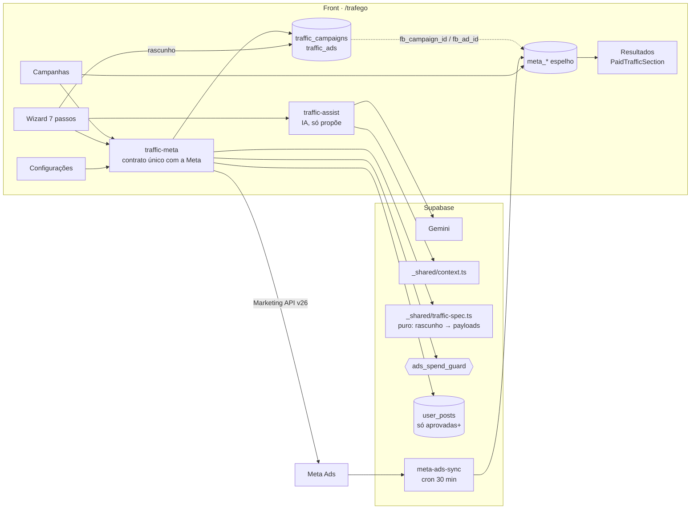

# PLANO — Módulo de Tráfego (distribuição de conteúdo)

Repositório: `piccini-dev/hive-resgate` · Base: `main` em `fb0591e` · Data: 2026-11-15
Planos anteriores: operação resgate (blocos 01–10) em [`PLANO-RESGATE.md`](PLANO-RESGATE.md); primeira versão do tráfego (09/11, substituída) em [`PLANO-TRAFEGO-ANTIGO.md`](PLANO-TRAFEGO-ANTIGO.md). Os blocos deste plano começam no **11**.

## 1. Objetivo e critério de pronto

**Objetivo:** a Hive ganha um **módulo de Tráfego**, separado da parte de conteúdo, onde o Marcos cria campanhas de **distribuição de conteúdo** na Meta (Facebook e Instagram) por um wizard que segue o fluxo do Gerenciador de Anúncios (campanha → conjunto → anúncio), mais simples e com a **recomendação da IA em todas as etapas**.

**O que o módulo compartilha com o conteúdo:** só a escolha dos conteúdos. O wizard puxa peças da Hive **aprovadas, agendadas ou publicadas**, nunca peças que ainda não foram aprovadas. Todo o resto (campanhas, configurações, resultados) mora no módulo.

**Pronto quando:**
1. O menu tem **Tráfego**, com as abas Campanhas, Nova campanha, Resultados e Configurações.
2. O Marcos cria uma campanha completa pelo wizard e ela aparece na Meta **pausada**. Ele a ativa com uma confirmação.
3. Cada etapa do wizard tem o painel **"A Hive recomenda"**, que o Marcos aplica com um clique ou ignora.
4. O seletor de conteúdo **não mostra** peça sem aprovação, e o servidor **recusa** se alguém mandar uma (teste cobre).
5. Nenhuma campanha é criada ou ativada acima do **teto mensal**: o servidor recusa e a recusa é testada.
6. A aba Campanhas mostra status, gasto, alcance e custo por resultado de cada campanha criada pela Hive, vindos do espelho `meta_*` (sem tabela nova de métricas).
7. A regressão completa fica verde e os specs novos cobrem o wizard, o filtro de aprovação, a recusa por teto e ativar/pausar.

## 2. Escopo

**Entra:**
- Módulo `/trafego` com menu próprio.
- Wizard com os **3 objetivos de distribuição** da Meta: Reconhecimento (`OUTCOME_AWARENESS`), Tráfego (`OUTCOME_TRAFFIC`) e Engajamento (`OUTCOME_ENGAGEMENT`).
- Opções do Gerenciador, simplificadas: orçamento diário ou total, programação, público (Advantage+ ligado/desligado, localização, idade, gênero, interesses), posicionamentos (automáticos ou manuais), identidade (Página e Instagram), texto, título, botão (CTA) e link de destino.
- Conteúdo de **qualquer peça com arte**: peça publicada no Instagram vira impulsionamento do próprio post; peça aprovada ou agendada (de qualquer rede) vira anúncio fora do feed, com a arte e o texto da peça.
- IA em cada etapa (Gemini, padrão do projeto), sempre como **proposta**: nunca grava nem gasta sozinha.
- Criar, ativar, pausar e encerrar campanhas na Meta; teto mensal no servidor.
- Mover a seção de tráfego pago (`PaidTrafficSection`) do comparativo de contas para a aba Resultados do módulo.
- Migrations aditivas e Edge Functions novas, com deploy feito só por ordem do Raul (ver §8).

**Não entra (agora):**
- Objetivos Leads, Vendas e Promoção de app (etapa de vendas, depois). A Eduzz fica para essa etapa (base no plano antigo).
- Propostas automáticas da Hive (cron que sugere o que impulsionar) e pausa automática por regra.
- Botão "Impulsionar" dentro da Agenda ou do editor da peça: o módulo é separado.
- Teste A/B, orçamento de campanha Advantage+ (CBO), lances manuais, públicos personalizados ou semelhantes, remarketing, Pixel.
- Anúncio em categoria especial (crédito, emprego, moradia, política): o wizard declara `special_ad_categories = []` e avisa que esse tipo não é suportado.
- Editar uma campanha depois de criada (além de ativar, pausar e encerrar). Para o resto, o link "Abrir no Gerenciador".
- LinkedIn Ads, Google Ads, TikTok e contas de anúncio de terceiros.

## 3. Usuários e fluxos

**Marcos** opera. **Raul** faz a configuração da primeira vez.

### F1 · Configurar (uma vez)
1. Configurações › Contas › Meta: reconectar o Facebook (o login passa a pedir `ads_management`).
2. Tráfego › Configurações: escolher a **conta de anúncio**, a **Página** e o **Instagram** que anunciam, e o **teto mensal** (R$).
3. Sem configuração completa, as outras abas do módulo mostram só o aviso com o link para Configurações.

### F2 · Nova campanha (o wizard)
Ordem igual à do Gerenciador, com um passo de conteúdo à frente (o módulo existe para distribuir conteúdo, e a IA recomenda melhor sabendo o que vai ser anunciado).

| Passo | O Marcos escolhe | A Hive recomenda |
|---|---|---|
| 1 · Conteúdo | 1 a 5 peças aprovadas, agendadas ou publicadas (busca, filtro por rede, miniatura da arte) | quais peças valem anunciar, pelo desempenho orgânico (`post_metrics`) e pela função estratégica |
| 2 · Campanha | objetivo (3 cartões) e nome | o objetivo, a partir das peças e de uma frase opcional "o que você quer com isso?"; o nome |
| 3 · Conjunto: orçamento e programação | diário ou total, valor, início e fim | valor e duração pelo histórico de custo da conta (`meta_ad_insights_daily`) e pelo que sobra do teto |
| 4 · Conjunto: público | Advantage+ ligado/desligado, localização, idade, gênero, interesses | o público, a partir da identidade e do público dos editoriais (`resolveContext`); interesses já buscados na Meta |
| 5 · Conjunto: posicionamentos | automáticos (recomendado pela Meta) ou manuais (Feed e Stories/Reels do Facebook e do Instagram) | posicionamentos pelo formato das peças (carrossel, imagem, reel) |
| 6 · Anúncio | identidade (vem da configuração); para cada peça: texto principal, título, botão e link (este só em Tráfego). Post do Instagram publicado usa o post como está | texto, título e botão na voz do Marcos, a partir da peça |
| 7 · Revisão | confere tudo e clica **Criar (pausada)** | checklist final: o que pode dar errado e o que melhorar; estimativa de alcance diário da Meta |

Depois de criar: a campanha aparece em Campanhas como **Pausada**, com **Ativar** (confirmação mostra valor e período). O rascunho do wizard fica salvo a cada passo e pode ser retomado.

### F3 · Acompanhar
1. Tráfego › Campanhas: lista das campanhas criadas pela Hive, com status, período, gasto, alcance, resultado e custo por resultado (do espelho, atualizado pelo sync de 30 min).
2. Ações: Ativar, Pausar, Encerrar, Abrir no Gerenciador.
3. Tráfego › Resultados: a visão geral da conta de anúncio (a `PaidTrafficSection` atual, que hoje fica no comparativo de contas).

## 4. Arquitetura

**Regras de arquitetura:**
- **Um contrato com a Meta:** toda leitura e escrita do módulo na Marketing API passa por `traffic-meta` (o token nunca vai ao navegador). Ações: `assets` (contas de anúncio, Páginas e Instagram do usuário), `search_locations`, `search_interests`, `estimate`, `create`, `set_status`.
- **Uma tradução:** `_shared/traffic-spec.ts` é puro (sem rede). Converte o rascunho do wizard nos payloads da Meta e valida combinações (objetivo × meta de otimização × destino × posicionamento). Testado por unitários.
- **Uma fonte de números:** métricas só do espelho `meta_*`. `traffic_campaigns` e `traffic_ads` guardam a **intenção** (o que a Hive criou e os ids da Meta), nunca métricas.
- **IA só propõe:** `traffic-assist` devolve recomendações em JSON; quem grava é o front, no rascunho, quando o Marcos aplica.
- **Separado do conteúdo:** o módulo **lê** `user_posts` e não escreve nada nele.

## 5. Stack e versões

Mantida (`package.json`). **Nenhuma dependência nova:** a Marketing API é chamada por `fetch` no Deno, como `_shared/meta-ads.ts` já faz; o wizard reaproveita `WizardShell` e `ChoiceCard` (`src/components/campaign/`).

| Peça | Versão | Conferido |
|---|---|---|
| Meta Graph / Marketing API | **v26.0** (o código atual usa v21.0 em 9 lugares) | Context7 (`/websites/developers_facebook_ads-commerce_marketing-api`), 2026-11-15 |
| Objetivos | `OUTCOME_AWARENESS` (meta `REACH`, `IMPRESSIONS`, `AD_RECALL_LIFT`, `promoted_object.page_id`) · `OUTCOME_TRAFFIC` (site: `LINK_CLICKS`, `LANDING_PAGE_VIEWS`) · `OUTCOME_ENGAGEMENT` + `destination_type=ON_POST` (`POST_ENGAGEMENT`) | idem |
| Público | `targeting.geo_locations`, `age_min/max`, `genders`, `flexible_spec.interests`; **`targeting_automation.advantage_audience` obrigatório (0 ou 1) desde a v23** ao criar conjunto | idem |
| Busca | `GET /search?type=adinterest&q=` e `type=adgeolocation` | idem |
| Posicionamentos | `publisher_platforms` (se informado, precisa incluir `facebook`), `facebook_positions` (`feed`, `story`, `facebook_reels`), `instagram_positions` (`stream`, `story`, `reels`); Stories exige `device_platforms: mobile` | idem |
| Permissões | `ads_read` + `ads_management`, acesso padrão (contas do próprio usuário) | Context7, 2026-11-09 |
| A conferir no bloco 12 | criativo de post do Instagram existente (`source_instagram_media_id`) e anúncio fora do feed com `object_story_spec` (imagem e carrossel); endpoint de estimativa (`delivery_estimate`) | — |

## 6. Modelo de dados

Tudo **aditivo** e idempotente, com rollback em `supabase/rollback/`. RLS `auth.uid() = user_id` em toda tabela nova (padrão do `20261002000001_trafego_pago.sql`).

### 6.1 Colunas novas em `meta_connections`
| Coluna | Tipo | Para quê |
|---|---|---|
| `ad_account_id` | text | conta de anúncio que o módulo usa (`act_…`) |
| `page_id` | text | Página que anuncia |
| `ig_user_id` | text | Instagram que anuncia |
| `monthly_cap` | numeric | teto mensal em R$ (nulo = módulo não cria nem ativa) |

### 6.2 `traffic_campaigns` (uma campanha do módulo = uma campanha + um conjunto na Meta)
| Campo | Tipo | Nota |
|---|---|---|
| `id` | uuid pk | |
| `user_id` | uuid fk auth.users | RLS |
| `name` | text | |
| `objective` | text check (`OUTCOME_AWARENESS`,`OUTCOME_TRAFFIC`,`OUTCOME_ENGAGEMENT`) | |
| `status` | text check | `draft` → `creating` → `paused` ↔ `active` → `ended`; também `failed` |
| `step` | smallint | último passo do wizard (retomar rascunho) |
| `draft` | jsonb | conjunto: orçamento (`budget_type` daily/lifetime, `amount`), `starts_at`, `ends_at`, `optimization_goal`, `targeting` (forma da Meta), `placements` (`auto` ou listas) |
| `ai_notes` | jsonb | última recomendação de cada passo (para mostrar de novo ao retomar) |
| `fb_campaign_id`, `fb_adset_id` | text | ligam ao espelho |
| `error` | text | última recusa da Meta, em português |
| `created_at`, `updated_at`, `activated_at`, `ended_at` | timestamptz | |

### 6.3 `traffic_ads` (um anúncio por peça escolhida)
| Campo | Tipo | Nota |
|---|---|---|
| `id` | uuid pk | |
| `user_id` | uuid | RLS |
| `campaign_id` | uuid fk traffic_campaigns on delete cascade | |
| `post_id` | uuid fk user_posts | a peça; o servidor confere status aprovada/agendada/publicada |
| `mode` | text check (`ig_post`,`new_creative`) | `ig_post` = post publicado no Instagram com `metadata.ig_media_id` (ou o id tirado do `published_url`, como o `mediaIdFromUrl` de `_shared/instagram-import.ts`); `new_creative` = arte de `rendered_slides` |
| `primary_text`, `headline`, `cta`, `link_url` | text | `link_url` obrigatório em Tráfego; recebe UTMs `utm_source=hive&utm_campaign=<id>` |
| `fb_creative_id`, `fb_ad_id` | text | ligam ao espelho `meta_ads` |
| `error` | text | |
| `created_at`, `updated_at` | timestamptz | |

### 6.4 Conteúdo elegível (regra única)
Peça do usuário com `status in ('approved','scheduled','published')` **e** com arte (`rendered_slides` não vazio ou `metadata.ig_media_id`). Fica numa view `traffic_eligible_posts` (com `security_invoker`), usada pelo seletor e conferida de novo pelo `traffic-meta` no `create`.

### 6.5 Guarda de verba
`ads_spend_guard(user_id, extra numeric)` (função SQL): compromisso do mês = soma das campanhas `active`/`creating` (diária × dias restantes no mês, ou o restante do total) + gasto real do mês no espelho + `extra`; compara com `monthly_cap`. O `traffic-meta` chama antes de `create` e de `set_status=ACTIVE`; acima do teto, recusa com o código `PT402`.

## 7. Integrações

### `traffic-meta` (Edge Function, JWT obrigatório)
| Ação | Entrada | Faz na Meta (v26.0) |
|---|---|---|
| `assets` | — | `GET /me/adaccounts`, `GET /me/accounts` (Páginas) e o `instagram_business_account` de cada Página |
| `search_locations` | `q` | `GET /search?type=adgeolocation` |
| `search_interests` | `q` | `GET /search?type=adinterest` |
| `estimate` | `campaign_id` | estimativa de alcance do conjunto (endpoint conferido no bloco 12) |
| `create` | `campaign_id` | valida o rascunho (`traffic-spec`), confere peças elegíveis e teto; cria campanha (`special_ad_categories=[]`, `PAUSED`) → conjunto → criativos → anúncios, todos `PAUSED`; grava os ids. Se falhar no meio, apaga o que criou e marca `failed` |
| `set_status` | `campaign_id`, `ACTIVE`/`PAUSED`/`ARCHIVED` | `POST /{fb_campaign_id}` `status=…` (ACTIVE passa pela guarda) |

Erros da Meta viram mensagem em português em `error`. O token sai de `meta_connections` com service role (`_shared/meta-ads.ts` já faz).

### `traffic-assist` (Edge Function, JWT obrigatório, rate limit)
Entrada `{ step: 'content'|'objective'|'budget'|'audience'|'placements'|'copy'|'review', campaign_id, hint? }`. Monta o contexto do passo (peças, identidade via `resolveContext`/`contextBlock`, histórico de `meta_ad_insights_daily`, teto restante), chama `callGeminiJson` (`_shared/gemini.ts`) e devolve `{ recommendation: <forma do campo do passo>, why: string }`. Não grava. Interesses sugeridos pela IA passam por `search_interests` antes de aparecer (só id real da Meta entra no público). O custo entra no registro de custos de API pelo `logUsage` (`_shared/security.ts`), como as outras funções de IA.

### Front
- `src/lib/edge.ts`: `trafficMeta(action, payload)` e `trafficAssist(step, payload)`.
- `src/lib/traffic.ts`: leitura e gravação de rascunho (`traffic_campaigns`, `traffic_ads`, `traffic_eligible_posts`) e configuração, via `db.ts`.

## 8. Convenções

- **Regras técnicas:** `AGENTS.md`. Diferença desta missão: o plano **precisa** de deploy de migration e de função. Todo deploy é tarefa `exec:claude` e só roda com ordem explícita do Raul, na ordem do AGENTS §3 (migration aditiva → função → app).
- **Pastas:** `src/pages/trafego/` (uma tela por aba e `wizard/` com um arquivo por passo), `src/components/traffic/` (painel "A Hive recomenda", cartão de campanha, seletor de peça), `supabase/functions/traffic-meta/`, `supabase/functions/traffic-assist/`, `supabase/functions/_shared/traffic-spec.ts` e `_shared/meta-marketing.ts` (chamadas de escrita, separadas do sync de leitura).
- **Abas por `?aba=`**, como no resto do resgate: `/trafego?aba=campanhas|nova|resultados|configuracoes`. Rascunho: `/trafego?aba=nova&id=<uuid>`.
- **UI:** linguagem do Gerenciador quando ela ajuda o Marcos a reconhecer a tela (Campanha, Conjunto, Anúncio, Público, Posicionamentos), com uma linha de explicação em cada passo. Nada de "bid", "CBO" ou "billing event". Painel da IA sempre no mesmo lugar (lateral no desktop, recolhível no topo em 375 px).
- **Testes:**
  - `e2e/unit-traffic-spec.spec.ts`: rascunho → payloads, combinações inválidas, `advantage_audience` sempre explícito, `publisher_platforms` com `facebook`, Stories → `mobile`.
  - `e2e/unit-traffic-guard.spec.ts` (se a guarda tiver parte pura) ou E2E da recusa `PT402`.
  - E2E do wizard com `mockEdge` para `traffic-meta` e `traffic-assist`. **A Meta nunca é chamada nos testes** (aqui ela gasta dinheiro).
  - Prova real: `exec:claude`, na conta de anúncio do Raul, campanha criada `PAUSED` e arquivada no fim. Só com ordem.
  - Somar `traffic_campaigns` e `traffic_ads` ao `E2E_OWNED_TABLES`.
- **Ambiente:** sem variável nova (usa `GEMINI` por usuário, `SUPABASE_*` e o token de `meta_connections`).

## 9. Segurança e dados pessoais

- **Dinheiro:** teto verificado **no servidor** (`ads_spend_guard`); tudo nasce `PAUSED`; ativar exige ação do usuário autenticado e passa pela guarda. Testes cobrem a recusa.
- **Aprovação:** o servidor confere de novo que cada peça é do usuário e está aprovada, agendada ou publicada; o filtro do front não basta.
- **Token da Meta** só no banco (RLS + service role); nenhuma resposta do `traffic-meta` devolve token.
- **IA:** `traffic-assist` não grava nem chama a Meta para escrever; prompt usa `resolveContext` (nada de "Bee/Marcos" fixo, regra 9 do AGENTS).
- **Site de teste = banco real:** uma campanha ativada no `hive-resgate` gasta de verdade. A confirmação de ativar mostra isso.
- **Auditoria de segurança** (módulo producao-cliente) no bloco 12 (contrato com a Meta) e no 15 (fechamento).

## 10. Blocos

| NN | Nome | Objetivo | Entregável verificável | Depende de | Tarefas |
|---|---|---|---|---|---|
| 11 | Base do módulo | O módulo existe e está configurado | Menu **Tráfego** com as 4 abas; Resultados com a `PaidTrafficSection` (sai do comparativo de contas); Graph v26 em todo o código; login pede `ads_management`; Configurações salva conta, Página, Instagram e teto; migration §6 aplicada | — | 7 |
| 12 | Contrato com a Meta | Criar e controlar campanhas com segurança | `traffic-meta` com as 6 ações; `traffic-spec` puro com unitários; `ads_spend_guard` recusando com `PT402`; prova real (campanha `PAUSED` na conta do Raul, arquivada); auditoria de segurança | 11 | 7 |
| 13 | Wizard | O Marcos monta e cria a campanha | 7 passos com rascunho salvo e retomável; seletor só com peças elegíveis; Revisão → Criar (pausada) pelo contrato; E2E com `mockEdge` | 12 | 7 |
| 14 | A Hive recomenda | IA em todas as etapas | `traffic-assist` com os 7 passos; painel "A Hive recomenda" com Aplicar em cada passo; interesses validados na Meta; custo registrado; E2E com `mockEdge` | 13 | 6 |
| 15 | Campanhas e fechamento | Acompanhar e controlar | Aba Campanhas com status e números do espelho; Ativar (confirmação + guarda), Pausar, Encerrar, Abrir no Gerenciador; regressão completa; `/impeccable critique` + `polish`; nota para o Marcos | 14 | 6 |

Ordem: 11 → 12 → 13 → 14 → 15, em sequência (13 e 14 mexem nos mesmos arquivos do wizard).

### Issues planejadas por bloco

Só as do bloco atual viram issue (`/issues`). As seguintes são detalhadas no `/integrar` do bloco anterior, sobre o código já integrado.

**11 · Base do módulo**
- `exec:claude` Migration aditiva: colunas §6.1, `traffic_campaigns`, `traffic_ads`, view `traffic_eligible_posts`, RLS e rollback. Deploy só com ordem.
- `exec:gpt` Rota `/trafego` com as 4 abas (arquivos novos em `src/pages/trafego/`; Campanhas e Nova campanha como placeholder), item **Tráfego** no `Sidebar.tsx` e rota no `App.tsx`; sem configuração completa, as abas mostram o aviso com link para Configurações.
- `exec:gpt` Aba Resultados renderiza a `PaidTrafficSection`; o `AccountsCompare` fica só com o orgânico e um link para `/trafego?aba=resultados`.
- `exec:gpt` Trocar `v21.0` por `v26.0` nos 9 lugares (`grep -rn "v21.0" src supabase/functions`), com a lista conferida dos campos removidos entre v21 e v26 que o sync usa.
- `exec:gpt` Somar `ads_management` ao `IG_SCOPE` do `AccountsPanel.tsx`.
- `exec:gpt` Aba Configurações: conta de anúncio (de `meta_ad_accounts`), Página, Instagram e teto mensal, gravando em `meta_connections`. (Na v1 do bloco, as listas vêm do espelho e das contas sociais; o `assets` do bloco 12 passa a alimentá-las.)
- `exec:claude` Cadastrar `hive-resgate.netlify.app` nas URIs de OAuth do app da Meta (o Raul faz no painel), conferir o papel do Facebook do Marcos no app, redeploy das funções em v26 (com ordem), reconectar o Facebook e E2E do módulo.

**12 · Contrato com a Meta**
- `_shared/traffic-spec.ts` (puro) + `e2e/unit-traffic-spec.spec.ts`.
- `_shared/meta-marketing.ts`: criar campanha, conjunto, criativo (post do Instagram e criativo novo de imagem/carrossel) e anúncio; mudar status; buscas (só `fetch`). Formatos de criativo conferidos no Context7 antes.
- `exec:claude` Migration `ads_spend_guard` + rollback.
- `traffic-meta/index.ts`: ações `assets`, `search_locations`, `search_interests`, `estimate`.
- `traffic-meta/index.ts`: ações `create` (com desfazer em falha) e `set_status`, guarda e conferência de elegibilidade.
- `src/lib/edge.ts` + `src/lib/traffic.ts`.
- `exec:claude` Deploy (com ordem), prova real `PAUSED`, E2E da recusa por teto e da peça não aprovada, auditoria de segurança.

**13–15** — detalhados no `/integrar` do bloco anterior.

## 11. Riscos e perguntas em aberto

| # | Risco | Mitigação |
|---|---|---|
| R1 | O OAuth da Meta recusa `hive-resgate.netlify.app` | Cadastrar o domínio no app da Meta no bloco 11 (`exec:claude`, o Raul faz no painel) |
| R2 | Token da Meta vence em **01/12/2026**; sem reconexão, sync e módulo param | Reconectar com `ads_management` no bloco 11, antes dessa data |
| R3 | Acesso padrão só vale se o Facebook do Marcos tiver papel no app ou a conta de anúncio for do mesmo Business | Conferir no bloco 11; se não, papel de testador ou acesso avançado (revisão da Meta, semanas) |
| R4 | Campanha ativada no site de teste gasta de verdade (mesmo banco) | Tudo nasce pausado, confirmação de ativar avisa, teto mensal no servidor |
| R5 | A Meta rejeita criativo ou combinação de opções | `traffic-spec` barra as combinações conhecidas antes; `failed` + mensagem em português; desfaz o que criou |
| R6 | Peça aprovada sem arte renderizada (`rendered_slides` vazio) | Fica fora da view de elegíveis; o seletor explica por quê |
| R7 | IA sugere interesse que não existe na Meta | Toda sugestão de interesse passa pela busca da Meta antes de aparecer |
| R8 | Testes não podem chamar a Meta | `mockEdge` no E2E; prova real só `PAUSED`, com ordem |

**Decisões (2026-11-15):**
- **D4 · Módulo separado:** Tráfego é uma aba própria; do conteúdo, só lê as peças aprovadas, agendadas ou publicadas. Substitui o princípio "anúncio = peça + verba + objetivo" do plano antigo.
- **D5 · O wizard cria na Meta** (não é só rascunho): tudo nasce pausado e o Marcos ativa com confirmação; teto mensal no servidor.
- **D6 · Só os 3 objetivos de distribuição** (Reconhecimento, Tráfego, Engajamento).
- **D7 · Qualquer peça com arte:** post publicado no Instagram é impulsionado; o resto vira anúncio fora do feed com a arte e o texto da peça.
- **D8 · Passo de conteúdo antes da campanha** (desvio do Gerenciador) para a IA recomendar sabendo o que vai ser anunciado. Aprovado pelo Raul.
- Do plano antigo **caem**: proposta automática, pausa automática, botão Impulsionar na peça e etapa de vendas (adiada). **Fica**: teto mensal no servidor, métricas só do espelho, Graph v26 e `ads_management`.

**Perguntas em aberto:**
- **P1** Qual conta de anúncio o Marcos vai usar?
- **P2** O Facebook do Marcos tem papel no app da Meta da Hive? (R3)
- **P3** Qual o teto mensal inicial? (sem ele, o módulo não cria nem ativa)
- **P4** Limite de 5 peças por campanha serve?
