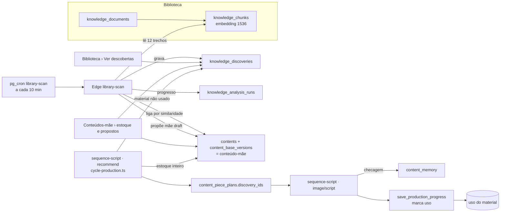

# PLANO — Reconstrução do fluxo de conteúdo (estoque vivo)

> Insumos: áudio do Marcos de 24/11 (`docs/plano/insumos/2026-11-24-audio-marcos-conteudo-mae.txt`) e a especificação dele no PR #85 (`docs/plano/insumos/ATUALIZACAO_1_IDENTIDADE_CONTEUDOS-pr85.md`, §4, §8 e §14).
> O plano do Tráfego (blocos 11–17) está **pausado** em [`PLANO-TRAFEGO.md`](PLANO-TRAFEGO.md) e volta depois desta reconstrução.
> Decisões do Raul em 25/11: varredura de tudo aos poucos; conteúdo-mãe novo é proposto e o Marcos valida; na campanha a Hive escolhe e o Marcos pode trocar; bloco 15 pausado.

## 1. Objetivo e critério de pronto

**Objetivo.** A Hive deixa de depender de o Marcos escolher bases fixas, que se esgotam depois de um post. O fluxo passa a ser o que ele descreveu:

```
Biblioteca → varredura (marca-texto) → descobertas → conteúdos-mãe vivos (estoque)
  → campanha: a Hive escolhe editorias, conteúdos-mãe e material → produção em formatos
```

**Por que isso acaba com a repetição.** Medimos em 24/11: as 4 produções que falharam vinham de bases já publicadas, e a IA, mesmo avisada, repete ou declara a base esgotada. Um post novo precisa de **material novo**. Cada recorte passa a carregar descobertas da Biblioteca que ainda não foram usadas; o material é registrado como usado quando a peça é produzida.

**Pronto quando**, no `hive-resgate`, logado como Marcos:
1. A Biblioteca mostra "Ver descobertas" com trechos marcados (tags, tipo e origem), e documento novo é varrido sozinho.
2. Conteúdos-mãe mostra o estoque: cada mãe com o material disponível ("6 materiais ainda não usados" ou "esgotado") e uma lista "Propostos pela Hive" para validar em lote.
3. Numa campanha nova, o Marcos não escolhe bases: a Hive propõe os recortes, cada um com o conteúdo-mãe e o material de origem, e ele aprova ou troca um item.
4. Uma produção de 5 peças a partir do estoque termina sem "retomou um argumento já publicado", e um teste sem gravar (como o de 24/11) confirma que as peças não repetem o acervo.
5. Regressão completa verde; `/impeccable critique` das telas novas sem P0.

## 2. Escopo

**Entra**
- **Estabilização (bloco 18, já pronta na branch `fix/estabilizacao`):**
  - checagem de repetição com o acervo inteiro (`content_memory`);
  - proposta que conhece o que cada base já publicou;
  - peças reservadas vazias fora das pendências;
  - fim do GitHub Pages: Supabase Auth apontando para o Netlify.
- Migration versionada das tabelas de descoberta que já existem no banco sem arquivo no repositório (`knowledge_discoveries`, `knowledge_analysis_runs`, criadas em 17/11 pela migration `identity_content_intelligence`), mais as colunas novas.
- Varredura contínua da Biblioteca por cron, em lotes pequenos.
- Conteúdo-mãe vivo:
  - descobertas ligadas a cada mãe;
  - estado do estoque;
  - proposta de mães novas validada pelo Marcos.
- Campanha em que a Hive escolhe conteúdo-mãe e material, com troca por item. Sai o passo de escolha manual de bases.
- Registro de uso do material na produção.

**Não entra**
- Monitoramento de desempenho e recomendação autônoma de temas (spec §9).
- Reescrever o motor de aprendizado.
- Migrar os 501 conteúdos legados (posts importados): eles continuam só como histórico na memória antirrepetição.
- Tirar o Arsenal (`bee_arsenal`, 83 itens) e a Curadoria: continuam como estão. A troca para "Configurações → Inteligência" fica para depois de as descobertas substituírem os consumidores (spec §8).
- Agenda, aprovação, publicação, Tráfego e editor visual.
- Várias marcas: o fluxo respeita `brand_id`, mas é testado com a marca Bee.

## 3. Usuários e fluxos

Usuário: **Marcos** (produtor). Raul acompanha e decide.

### F1 · Biblioteca vira estoque (sem ação do Marcos)
1. O Marcos sobe um documento na Biblioteca (fluxo atual `ingest-document`).
2. O cron `library-scan` pega o próximo trecho não varrido de qualquer documento e lê 12 trechos por chamada.
3. Para cada passagem que pode render conteúdo, grava uma **descoberta**: título, resumo, trecho literal curto, tipo (caso, conceito, pergunta, dado, história ou prática), tags e origem (documento e trecho).
4. Em seguida, liga cada descoberta ao conteúdo-mãe mais próximo (similaridade) ou a deixa solta.
5. "Ver descobertas" mostra a lista com filtro por tag, tipo, documento e "solta". O Marcos pode descartar ou corrigir uma descoberta; não precisa aprovar.

### F2 · Conteúdos-mãe vivos
1. Quando há descobertas soltas suficientes sobre um mesmo assunto (mínimo de 3), a Hive propõe um **conteúdo-mãe**: frase e texto amplos, e os recortes possíveis, sem ser post. Ele usa as descobertas como fonte.
2. Em Conteúdos-mãe › "Propostos pela Hive", o Marcos valida, edita ou descarta, em lote. Validar usa o contrato atual de versão (`content_base_versions`).
3. Cada mãe mostra seu material: descobertas ligadas, quais já foram usadas e em qual peça. Mostra também o estado do estoque: **vivo** (há material não usado) ou **esgotado**.

### F3 · Campanha: a Hive escolhe
1. Criar campanha e ciclo segue igual (estratégia, ACJ, duração).
2. Na Produção, o passo "escolher bases" deixa de existir. Em "Proposta de produção", a Hive monta os recortes a partir do **estoque inteiro**: conteúdos-mãe validados com material não usado, filtrados pelas editorias e pela estratégia.
3. Cada recorte mostra o conteúdo-mãe, as 1–2 descobertas de material novo, a editoria, o formato e o porquê.
4. O Marcos aprova ou, num item, toca em "Trocar" para escolher outro mãe ou outro material da lista disponível.
5. Se o estoque não bastar, a proposta diz isso ("3 conteúdos-mãe esgotados; a Biblioteca tem 40 descobertas soltas aguardando virar mãe") e leva a F2.

### F4 · Produção sem repetição
1. Produção como hoje, um por vez. O texto que a IA recebe inclui o material novo da peça ("MATERIAL NOVO DESTA PEÇA").
2. A checagem de repetição continua como rede de segurança, já com o acervo inteiro (bloco 18).
3. Quando a peça é produzida, as descobertas dela ficam marcadas como usadas e não entram no próximo recorte.

## 4. Arquitetura



- **Uma função nova:** `library-scan` (varredura, ligação e proposta de mãe). Ela é chamada pelo cron com a service role e o cabeçalho `x-bee-user-id` (padrão `internalUserId`), e pelo app com JWT ("varrer agora", só para o próprio usuário).
- **Contratos estendidos, sem atalho (AGENTS regra 7):**
  - a proposta continua em `recommendCycleProduction` (`_shared/cycle-production.ts`, ação de `sequence-script`);
  - a aprovação continua em `approve_cycle_production`;
  - o progresso continua em `save_production_progress`;
  - a validação de mãe continua no fluxo atual de Conteúdos-mãe.
- **Lógica pura** em `_shared/discovery.ts` e `src/lib/campaign/stock.ts` (testável em Node, como `production-novelty.ts`).

## 5. Stack e versões

Sem dependência nova. React 18 + Vite + TypeScript + Tailwind + Zustand. Supabase (Postgres com pgvector, RLS, Edge Functions Deno, pg_cron, `net.http_post` com o segredo `service_role_key` do Vault, como o `campaign-tick`).

IA pela chave Gemini do usuário (`getUserGeminiKey`):
- **Texto:** `MODEL_CHAIN` de `_shared/gemini.ts` (`gemini-3.5-flash` → `gemini-3.1-flash-lite` → `gemini-2.5-pro`).
- **Embedding:** `gemini-embedding-001`, 1536 dimensões (`_shared/embed.ts`).

A similaridade de descoberta reutiliza o embedding do trecho de origem (`knowledge_chunks.embedding`), sem chamada nova.

## 6. Modelo de dados

Tudo em migration aditiva e idempotente, com rollback em `supabase/rollback/`.

### 6.1 `knowledge_discoveries` (já existe no banco; o arquivo passa a existir no repositório)

| Coluna | Tipo | Situação |
| --- | --- | --- |
| `id` | uuid | existente |
| `user_id` | uuid | existente |
| `brand_id` | uuid | existente |
| `document_id` | uuid | existente |
| `title` | text (1–240) | existente |
| `summary` | text (1–6000) | existente |
| `sources` | jsonb (array) | existente; formato `[{document_id, chunk_id, chunk_index, title}]` |
| `status` | text: `active`, `dismissed` ou `drafted` | existente; `drafted` = está numa proposta de mãe |
| `content_id` | uuid | existente; mãe a que a descoberta está ligada |
| `created_at` | timestamptz | existente |
| `kind` | text: `caso`, `conceito`, `pergunta`, `dado`, `historia` ou `pratica` | **nova** |
| `tags` | text[], padrão `{}` | **nova** |
| `excerpt` | text (≤ 600), trecho literal | **nova** |
| `chunk_id` | uuid, FK `knowledge_chunks` com `ON DELETE SET NULL` | **nova** |
| `link_similarity` | real | **nova** |
| `updated_at` | timestamptz | **nova** |

Unicidade existente: `(user_id, document_id, title)`. RLS existente: `discoveries_own`.

### 6.2 `knowledge_analysis_runs` (já existe)

- Chave existente: `(document_id, user_id)`.
- Colunas existentes: `brand_id`, `status` (`running`, `completed` ou `failed`), `claim`, `started_at`, `finished_at`, `found`, `error`.
- **Nova:** `next_chunk int not null default 0`, o cursor da varredura em lotes.

### 6.3 Uso do material

- `content_piece_plans.discovery_ids uuid[] not null default '{}'` (**nova**).
- Uma descoberta conta como **usada** quando aparece em `discovery_ids` de um plano com `status = 'produced'`.
- Uma descoberta está **reservada** quando aparece num plano `planned` do lote aprovado atual.
- A regra fica numa view `discovery_availability(discovery_id, user_id, content_id, state)`, com `state` = `livre`, `reservada` ou `usada`, e é usada pelo front e pela proposta.

### 6.4 Conteúdo-mãe

Não muda de tabela: `contents` + `content_base_versions`.
- **Proposta da Hive:** versão `draft` com `contents.metadata.origin = 'discovery'` e `metadata.discovery_ids`.
- **Estoque de uma mãe:** descobertas `active` ligadas por `content_id` e `livre` em `discovery_availability`. Com zero livres, a mãe está **esgotada**.

## 7. Integrações

### `library-scan` (Edge Function nova)
- **Autenticação:** JWT do usuário, ou service role + `x-bee-user-id` (cron).
- **Entrada:** `{ "action": "tick" }` (cron: processa até 3 lotes de 12 trechos no total, entre todos os usuários), `{ "action": "scan", "document_id": "<uuid>" }` (app: próximo lote desse documento), `{ "action": "propose_mothers" }` (app ou cron: propõe mães a partir das soltas).
- **Saída:** `{ "success": true, "processed": n, "found": n, "linked": n, "proposed": n }`.
- **Rate limit:** `checkRateLimit`. Uso registrado com `logUsage` (`fn: 'library-scan'`).
- **Claim:**
  - Lê `knowledge_analysis_runs` com `claim` e `started_at`. Um lote parado há mais de 10 min é retomado.
  - Quando `next_chunk` alcança `chunk_count`, o status vira `completed`.
  - Documento novo ou com mais trechos que o cursor volta a ser varrido.

### `sequence-script` (estendida)
- **Proposta** (`recommendCycleProduction`):
  - recebe o estoque (mães validadas da marca, com as descobertas livres de cada uma e o `ja_publicado` do bloco 18);
  - devolve `items[].discovery_ids` (1 ou 2, do próprio mãe, livres);
  - `usableProductionProposals` descarta o item cujo material não confere.
- **Geração** (`image`, `script`): o texto que a IA recebe ganha o material das `discovery_ids` do plano.

### RPCs (estendidas por migration)
- `approve_cycle_production`: grava `discovery_ids` e cria `content_base_uses` dos mães escolhidos pela Hive. A tela deixa de chamar o seletor de bases.
- `save_production_progress`: com `p_done`, a peça só termina se as `discovery_ids` do plano ainda estiverem livres para ele (sem corrida entre duas produções).

## 8. Convenções

- **Regras técnicas:** `AGENTS.md`. Migration, deploy de função e cron são tarefas `exec:claude`, na ordem do AGENTS §3: migration aditiva → função → app.
- **Pastas:**
  - `supabase/functions/library-scan/index.ts`;
  - `supabase/functions/_shared/discovery.ts` (puro: parse e validação da resposta da IA, montagem dos lotes, escolha de ligação por similaridade, agrupamento de soltas);
  - `src/lib/campaign/stock.ts` (puro: estado do estoque e material disponível por mãe);
  - `src/lib/discoveryApi.ts` (REST via `db.ts`);
  - telas em `src/pages/biblioteca/` (descobertas) e `src/pages/conhecimento/MotherContents.tsx` (estoque e propostos).
- **Testes:**
  - unitários `e2e/unit-discovery.spec.ts` e `e2e/unit-stock.spec.ts`, e mais casos em `e2e/unit-production-plan.spec.ts`;
  - E2E novo `e2e/f35-estoque-vivo.spec.ts` com `mockEdge` para `library-scan` e `sequence-script`; somar as tabelas novas ao cleanup do usuário de teste;
  - teste real sem gravar (script em `scripts/`, como o de 24/11), `exec:claude`.
- **Ambiente:** sem variável nova.

## 9. Segurança e dados pessoais

- **RLS** em tudo que é novo, por `user_id`. A view `discovery_availability` usa `security_invoker`.
- **`library-scan`:**
  - no modo cron, aceita a service role só com `x-bee-user-id`;
  - no modo app, ignora qualquer `user_id` do corpo.
- **Biblioteca tem casos reais de clientes e alunos.**
  - A descoberta guarda o trecho para o Marcos conferir, mas os textos que a IA recebe na geração mantêm a regra atual: nada de caso real, nome ou detalhe identificável, só princípios e exemplos explicitamente fictícios.
  - O `excerpt` nunca vai para post.
- **Voz (AGENTS regra 9):** nada vira metodologia sem curadoria. A descoberta é material, não regra; o conteúdo-mãe só entra validado pelo Marcos.
- **Custo:** a varredura usa a chave do Marcos. O cron limita a 3 lotes por execução e para no erro 429.
- Auditoria de segurança no fechamento do bloco 19 (nova função com service role).

## 10. Blocos

| NN | Nome | Objetivo | Entregável verificável | Depende de | Tarefas |
| --- | --- | --- | --- | --- | --- |
| 18 | Estabilização | Parar os incêndios e preparar o terreno | Branch `fix/estabilizacao` integrada; `sequence-script` publicada; Supabase Auth apontando para o Netlify; GitHub Pages desligado; regressão verde | — | 4 (todas `exec:claude`) |
| 19 | Dados do estoque | Tabelas de descoberta no repositório, colunas novas e regra de disponibilidade | Migration e rollback aplicados; `discovery_availability` respondendo; `stock.ts` e `discoveryApi` com testes | 18 | 5 |
| 20 | Varredura da Biblioteca | O marca-texto: descobertas a partir dos documentos | `library-scan` publicada e no cron; "Ver descobertas" na Biblioteca; documento de teste vira descobertas com tags e origem | 19 | 7 |
| 21 | Conteúdos-mãe vivos | Ligar descobertas aos mães, propor mães novos, mostrar o estoque | Os 10 mães atuais ligados ao material; "Propostos pela Hive" com validação em lote; estado vivo ou esgotado por mãe | 20 | 6 |
| 22 | Campanha: a Hive escolhe | Proposta a partir do estoque inteiro, com material e troca por item | Sem seletor de bases; cada recorte com mãe e material; aprovar grava `discovery_ids` e os usos | 21 | 7 |
| 23 | Produção com material novo | O material entra na geração, o uso fica registrado e o fluxo é testado de ponta a ponta | Geração com "MATERIAL NOVO"; uso marcado; `f35` verde; teste real sem repetição; critique sem P0 | 22 | 6 |

### Tarefas previstas por bloco

**18 · Estabilização** (`exec:claude`)
1. Revisão final e PR de `fix/estabilizacao`; regressão local isolada (`validar:local:completa`).
2. Deploy da `sequence-script`; conferir a versão pela Management API.
3. Supabase Auth: `site_url` = `https://hive-resgate.netlify.app/` e `uri_allow_list` com `https://hive-resgate.netlify.app/**` e `http://localhost:5173/**`, sem as entradas do `github.io`. Testar "Esqueci minha senha".
4. Merge na `main`; desligar o GitHub Pages do repositório; fechar a #111 (migration já aplicada) e registrar a migration órfã no bloco 19.

**19 · Dados do estoque**
1. Migration `AAAAMMDD_estoque_vivo.sql`, `exec:claude`: `CREATE TABLE IF NOT EXISTS` idêntico ao banco para as duas tabelas, colunas novas, `content_piece_plans.discovery_ids`, view `discovery_availability`, rollback.
2. Tipos `KnowledgeDiscovery`, `DiscoveryState` e `MotherStock` em `src/types/`.
3. `src/lib/campaign/stock.ts`: `motherStock(mother, discoveries, availability)` → `{ livres, usadas, estado }`, com testes.
4. `src/lib/discoveryApi.ts`: listar por filtro, descartar, corrigir título/tags, mover para outra mãe; com testes de montagem de query.
5. E2E cleanup: tabelas novas em `E2E_OWNED_TABLES`, fixture `seedDiscoveries`.

**20 · Varredura da Biblioteca**
1. `_shared/discovery.ts`:
   - `scanBatch(chunks)` monta o texto que a IA recebe;
   - `parseDiscoveries(data, chunkIds)` valida a resposta (tipo, tags ≤ 6, excerpt literal presente no trecho, título 1–240);
   - testes.
2. `_shared/discovery.ts`: `pickMother(similarities, threshold)` para ligar ou deixar solta; testes.
3. `library-scan`: ações `scan` e `tick` com claim, cursor e `completed`.
4. `library-scan`: ligação por similaridade (embedding do trecho × embedding do texto do mãe, guardado em `contents.metadata.embedding` ou calculado e cacheado na própria função).
5. Cron `library-scan` a cada 10 min e deploy (`exec:claude`); primeira execução acompanhada.
6. Tela "Ver descobertas" (Biblioteca): lista, filtros, descartar e corrigir; vazio e carregando claros.
7. E2E `f35` parte 1 (descobertas com `mockEdge`).

**21 · Conteúdos-mãe vivos**
1. `_shared/discovery.ts`: `groupLoose(discoveries, minSize=3)` (agrupa soltas por similaridade de tags e embedding); testes.
2. `library-scan` ação `propose_mothers`: a IA escreve mãe amplo (frase, texto, recortes possíveis) a partir de um grupo; grava `contents` + versão `draft` + `status = drafted` nas descobertas.
3. Conteúdos-mãe: seção "Propostos pela Hive" com validar, editar e descartar em lote (reusa a validação de versão atual).
4. Conteúdos-mãe: estoque por mãe (material, usadas, vivo ou esgotado).
5. Ligação dos 10 mães atuais ao material existente, `exec:claude`: rodar `tick` até cobrir a Biblioteca e conferir a amostra com o Raul.
6. E2E `f35` parte 2.

**22 · Campanha: a Hive escolhe**
1. `recommendCycleProduction`: estoque inteiro (mães validados com material livre), `discovery_ids` por item e as regras de escolha no texto que a IA recebe.
2. `usableProductionProposals`: valida `discovery_ids` (do próprio mãe, livres, 1 ou 2, sem repetir no lote); testes.
3. Migration `approve_cycle_production` (`exec:claude`): grava `discovery_ids`; cria `content_base_uses` dos mães escolhidos.
4. ProductionHub: tirar o passo do `CampaignBasePicker`; mostrar mãe e material por recorte.
5. "Trocar" num recorte: lista de mães e material livre; `productionProblems` cobre a troca inválida.
6. Aviso de estoque insuficiente, com link para Conteúdos-mãe.
7. E2E `f29`/`f33` ajustados e `f35` parte 3.

**23 · Produção com material novo**
1. `sequence-script` (`image` e `script`): bloco "MATERIAL NOVO DESTA PEÇA" a partir das `discovery_ids` do plano.
2. Migration `save_production_progress` (`exec:claude`): conferir material livre no `p_done`.
3. Deploy da `sequence-script` e da migration (`exec:claude`).
4. Teste real sem gravar (script) com 5 recortes do estoque; relatório para o Raul.
5. `/impeccable critique` e `polish` das telas novas (descobertas, estoque, proposta).
6. Regressão completa e nota para o Marcos.

## 11. Riscos e perguntas em aberto

- **Qualidade da varredura.** O sucesso depende de a IA marcar trechos úteis, e não tudo. Mitigação: limite de descobertas por lote, `excerpt` obrigatório e literal, e conferência de uma amostra com o Raul no bloco 20 antes de ligar o cron em todos os documentos.
- **Custo e cota do Gemini** na chave do Marcos (cerca de 1.400 chamadas para 17 mil trechos). Mitigação: 3 lotes por execução, parada no 429 e progresso visível.
- **Casos reais na Biblioteca.** Risco de o material levar o nome de um cliente para o post. Mitigação: a regra de anonimização continua na geração, e a checagem de repetição não substitui revisão.
- **Mães propostos rasos ou demais.** Mínimo de 3 descobertas por grupo, e o Marcos valida em lote. Se a proposta vier ruim, ajustamos o texto que a IA recebe antes de ligar a proposta no cron.
- **Migration órfã de 17/11** (`identity_content_intelligence`): o arquivo do bloco 19 precisa reproduzir exatamente o que já existe. O P1 começa lendo o schema real.
- **Contrato da aprovação:** o app antigo (Netlify em deploy) ainda chama o seletor de bases. Ordem: migration aditiva → função → app. A coluna nova tem padrão `{}`, então o contrato antigo segue funcionando.
- **Pergunta para o Marcos (antes do bloco 21):** os 10 mães atuais continuam como estão (com material ligado) ou ele quer reescrever algum ao ver o material?
